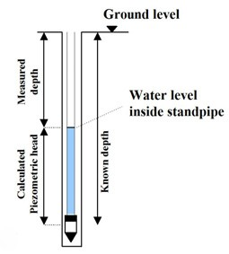
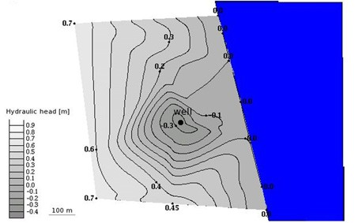

---
numbering:
  enumerator: 4.%s
---

(sec-4-3)=
# 4.3. Water flow in the subsurface

(sec-4-3-1)=
## 4.3.1. The driving force

The hydrologic cycle, powered by the sun, could be imagined as an "engine" or said to be the driving force of the water flowing through the ground. Basically, subsurface flow involves a transformation of potential and pressure energy into kinetic energy and losses due to friction. Water with high potential energy will move toward areas with low potential energy. This information is enough when dealing with unconfined aquifers. However, when confined aquifers are introduced we also need to consider the pressure acting on the water (see {ref}`fig_aquifer_aquitard_simple_crosssection`). To get a general description which serves for both unconfined and confined aquifers we have to consider both aspects. For this Bernoulli's equation known from flow mechanics is used that gives the hydraulic head, $h$. (Note that we assume the system of study to be at steady state).

:::{math}
h=z+\frac{p}{\rho g}=z+\psi
:::

where $z$ is the elevation of the measurement point, $p$ is the fluid pressure (relative to the atmospheric pressure) and $\rho$ is the elevation of water column in the measuring device (piezometer). {ref}`fig_groundwater_pressure_a_piezometer` shows such a piezometer and {ref}`fig_groundwater_pressure_b_contour` an example of a an investigated aquifer with some measured hydraulic heads using piezometers. The head loss or difference in hydraulic head between two measure points is given by:

:::{math}
\Delta h = (z_{1} + \psi_{1}) - (z_{2} + \psi_{2})
:::

Assuming that the aquifer is unconfined we could estimate the groundwater contour lines and the main groundwater flow direction, which is perpendicular to the groundwater contour lines. (You may use the groundwater contour line estimation applet[^gw_contourline_estimation_app] on the course homepage[^course_homepage] for further studies!). In the case of a confined aquifer the contour lines would represent the hydraulic head, not the actual groundwater surface.

:::{figure}
:label: fig_groundwater_pressure

(fig_groundwater_pressure_a_piezometer)=

(fig_groundwater_pressure_b_contour)=

Piezometer and groundwater contour lines of an exploited aquifer located close to the sea. The effect of the pumping is seen as a cone of depression around the pumping well (generated using the groundwater contour estimation applet).
:::

(sec-4-3-2)=
## 4.3.2. Flow velocities

Up to now we have looked at the driving force of groundwater flow, i.e. potential or hydraulic head. We have looked at two different points and given an expression for the difference in hydraulic head. We also have to consider the distance between the points of measure, since it is pretty obvious that the gradient between these points would affect the velocity of the groundwater. The French civil engineer Henry Darcy made the discovery that the flow rate through porous media is proportional to the head loss and inversely proportional to the length over which the head loss is observed (which means that flow through a porous medium is linearly related to the forces causing the flow). Adding a proportionality constant to these statements give us an equation widely used in hydrogeology, called **Darcy's law**[^Darcys_law], which in 1-D is written as

:::{math}
:label: eq_darcys_law
q = -K\frac{dh}{dx}
:::

Here $q$ [L/T] is the specific discharge or simply the Darcy velocity. The constant $K$, called **hydraulic conductivity** accounts for influencing factors such as the properties of the soil as well as the fluid (water). Darcy's law gives an accurate description of laminar flow such as in groundwater where we commonly due to the low velocity assume laminar flow everywhere. However, if we look at for instance the vicinity of a well, we would actually observe turbulent flow (the Reynolds number may be used to characterize the different flows, a low Reynolds number ($\mathrm{Re} \ll 1$) implies laminar flow; see {ref}`Section 1.4.3. <sec-1-4-3>` for further explanation).

The specific discharge $q$ is related to the volumetric flow rate $Q$ [L{sup}`3`/T] by dividing by the cross section area $A$ [L{sup}`2`] perpendicular to the flow direction,

:::{math}
q = \frac{Q}{A}
:::

Thus, the specific discharge is the volumetric flow rate per unit surface area, i.e. the amount of water flowing through a specified area per unit time. Looking at the unit [L/T] one could assume $q$ to be the velocity of the moving groundwater, however, "superficial velocity" would be a better description. To get a measure of the velocity, pore spaces, through which fluid flows, have to be considered. We have already mentioned the porosity in previous section, which describes the percentage of voids in a medium. We remember that not all pores are continuous and permit flow to pass through. Therefore, we use the effective porosity $n_e$, which is the percentage of pores through which water can flow. The **average pore water velocity** is then given by:

:::{math}
v = \frac{q}{n_{\mathrm{e}}}
:::

This velocity has many different names, for example: Average linear velocity (@fetter1994), linear velocity or pore velocity (@domenico1998), average interstitial velocity (@todd1980). It is also commonly referred to as advective velocity.

(sec-4-3-3)=
## 4.3.3. Solving the flow equation - Setting up a groundwater model

The groundwater velocity alone is not enough to determine the flow direction or contaminant transport; we have to know where the water is moving. As described in {ref}`Section 1.4.2.3. <sec-1-4-2-3>`, groundwater also has to fulfill the continuity equation (Eq. {ref}`eq_continuity`). If we assume a porosity of the transport medium that remains constant in time and space, the 3-dimensional mass balance equation to be solved is:

:::{math}
\rho\frac{\partial q_{x}}{\partial x} + \rho\frac{\partial q_{y}}{\partial y} + \rho\frac{\partial q_{z}}{\partial z} = \rho S_{\mathrm{S}} \frac{\partial h}{\partial t}
:::

with $S_{\mathrm{S}}$ as the specific storage [1/L] (volume of water stored or released per unit area when $h$ changes by one unit). If we divide by the water density and use Darcy's law in 3-D to express the velocity components we get

:::{math}
:label: eq_blw_darcy_3D
\frac{\partial}{\partial x}\left(K_{x}\frac{\partial h}{\partial x}\right) + \frac{\partial}{\partial y}\left(K_{y}\frac{\partial h}{\partial y}\right) + \frac{\partial}{\partial z}\left(K_{z}\frac{\partial h}{\partial z}\right) = S_{\mathrm{S}}\frac{\partial h}{\partial t}
:::

which may be further simplified if assuming $K$ as the hydraulic conductivity in all directions, which is true for homogeneous and isotropic aquifers. The obtained expression can also be written for horizontal flow using the storativity ($S$ [-], which is the specific storage $S_{\mathrm{S}}$ times the aquifer thickness $b$) and the transmissivity $T$, defined as $K \times b$ as shown below.

:::{math}
\frac{\partial^{2} h}{\partial x^{2}} + \frac{\partial^{2} h}{\partial y^{2}} + \frac{\partial^{2} h}{\partial z^{2}} = \frac{S_{\mathrm{S}}}{K} \frac{\partial h}{\partial t} \quad \Leftrightarrow \quad \frac{\partial^{2} h}{\partial x^{2}} + \frac{\partial^{2} h}{\partial y^{2}} = \frac{S}{T} \frac{\partial h}{\partial t}
:::

To be able to define and solve the flow equation for a specific problem we first need to consider a number of important aspects that help us either to simplify or to work out the equation:

- What is the general geology of the area?
- Is the aquifer confined or unconfined (influences boundary conditions)?
- Do we have homogeneous or heterogeneous conditions in the aquifer (influences $K$)?
- Do we have isotropic or anisotropic conditions in the aquifer (influences $K$)?
- Is the system in steady-state or transient (influences initial conditions)?
- What dimension is relevant for the model (1-D, 2-D or 3-D)?

After deciding about the main characteristics of our problem, the first step in defining the flow model is to define the system boundaries. Due to the fact that groundwater is in constant movement it must be considered as an open system. So when outlining the area of study we have to describe how the system communicate/is affected by the surrounding environment. In a groundwater system boundaries can be divided in two categories **physical boundaries** as well as **hydraulic boundaries**. Physical boundaries are for example some rock or formations creating an impermeable body that limits the movement of the groundwater. Hydraulic boundaries are for example groundwater divides or streamlines. There are three common types which are **head boundaries**, **flow boundaries** and **head dependent flow boundaries**.

Our aim is of course to solve the flow equation. In cases with simple geometries, homogeneous conditions and given boundary and initial conditions we may use analytical solution methods. For more complex problems, such as for three-dimensional contaminant transport, we have to use numerical solutions.

<!-- SUGGESTION: Can make it look like that -> No numbering, its the only example -->
::::{admonition} 📝 **Example: Simple model**
:class: seealso
:icon: false
An example of a very simple analytical solution is the recharge - discharge approach. It assumes that almost all the water in the considered system origins from precipitation; however, the water can take different paths before infiltrating into the ground. It could be transported as surface water into lakes or rivers, where it ultimately could be infiltrated to the groundwater. So the recharge could be from for example a river or lake. In simple cases, the recharge can in be estimated as

:::{math}
I \times A \times \phi
:::

where $I$ is precipitation (e.g., in mm/yr), $A$ is the area from which the aquifer receives water, and $\Phi$ is the fraction of the precipitation which reaches the aquifer
::::

Solving the flow equation normally requires the definition of some properties of the system. The effect of the geological formations (such as the soil in the aquifer) on the flow of water and the transport of contaminants is described by setting different soil properties. The data for these properties can be obtained from literature (first approximations, usually wide ranges), sieve analysis to find correlations of grain sizes and the mediums ability to transmit water, laboratory investigations and field tests (e.g. pumping or injection tests). {ref}`fig_hydro_charac_soil` provides hyrdogeological characteristics of the most common soil types.

:::{figure} ../images/fig_hydro_charac_soil.jpg
:label: fig_hydro_charac_soil
:width: 500px
Typical hyrdogeological characteristics of common soil types (@schnoor1996).
:::

(sec-4-3-4)=
## 4.3.4. Example Landfill - Modeling flow

In a small community highly dependent on groundwater as its main water resource, it was found that the water quality in a number of wells suddenly began decreasing. The families affected had to abandon their wells due to bad taste and smell. A quick test of the chemistry of the water from the wells showed a high content of dissolved solids. An investigation was initiated to find the source of the contamination and to reduce further spreading of the contaminants to other wells in the area.

As a first step to understand the problem it would be interesting to see how the groundwater moves. With little or no previous knowledge about the conditions in the subsurface we could begin by measuring the hydraulic head in the geologic formation from where water was extracted, by installing piezometers. This would give an overview of the flow situation.

It was decided to build a simple model, to give some more insight into the problem. As a first step we will make an outline of the system: So we need to decide what area is of interest. After a rough estimation of the groundwater flow, the search for possible contaminant sources was initiated. Following the estimated flow lines in the opposite direction of flow, a landfill was found in the outskirts of a nearby village approximately 2 km upstream from the affected wells. In this case the area of interest was between the landfill and the affected wells.

:::{figure} ../images/fig_ex_landfill_model.png
:label: fig_ex_landfill_model
:width: 500px
The left figure shows the model area. The right figure shows groundwater contour lines and flow-direction in this area.
:::

From measurements done over time we see only small fluctuation of hydraulic head in the area. We therefore assume that the set up is in steady state. In a next step we need to decide the required dimensions of our model. Is it relevant to setup a complex 3D model or is it enough with a 1-D model? From the contour map it is seen that the flow is fairly uniform. With this information we can assume no flow perpendicular to the general flow direction, therefore the system can be reduced to only two dimensions: a horizontal direction along the flow lines and a vertical direction. A geological investigation of the area showed that the aquifer in question was confined and bounded in the vertical direction by clay layers. We decide to consider the clay layers as upper and lower no-flow boundaries. However, we could also simplify the problem even more and assume that there is no flow in the vertical direction. With these restrictions the system can be reduced to only one dimension, which is in the direction of the flow.

:::{figure} ../images/fig_ex_landfill_crosssection.jpg
:label: fig_ex_landfill_crosssection
:width: 500px
A much simplified cross-section of the model area.
:::

We will now apply the flow equation stated in the previous section. It must however be rewritten to represent our current system. Since our system is in steady-state which gives $S_{\mathrm{S}}(\partial{h}/\partial{t}) = 0$, the flow Eq. {ref}`eq_blw_darcy_3D` simplifies to

:::{math}
:label: eq_blw_darcy_3D_steady_state
\frac{\partial}{\partial x}\left(K_{x}\frac{\partial h}{\partial x}\right) + \frac{\partial}{\partial y}\left(K_{y}\frac{\partial h}{\partial y}\right) + \frac{\partial}{\partial z}\left(K_{z}\frac{\partial h}{\partial z}\right) = 0
:::

The solution to this equation describes the value of the hydraulic head at any point in a three dimensional flow field. Assuming homogeneous and isotropic properties of the aquifer and reducing it to 1-D, we get the well-known Laplace equation (in 1-D).

:::{math}
\frac{d^{2}h}{dx^{2}} = 0
:::

Now this differential equation is ready to be applied to the model we have set up. The differential equation can be solved analytically and results in a linear function: $h_{x} = ax + b$ (where $a$ and $b$ are constants). However, we need two boundary conditions, that is two measurements of the hydraulic head: $h_1$, $h_2$ to calculate $a$ and $b$. With this simple model, showing that the hydraulic head is a linear function of distance $x$, we can make a rough estimation of the (Darcian) flow velocity simply by using Darcy's law and the effective porosity of the medium (sand). With an approximation of the advective velocity (average pore velocity), we can start to look at the contaminant transported from the landfill.

(sec-4-3-5)=
## 4.3.5. Example Landfill - Modeling of a well

As mentioned earlier it is important to know the hydraulic conductivity of the aquifer. This can be approximated for example by investigating the soil type and acquire standard values from a textbook. However, the accuracy of this approximation is very uncertain. To improve the accuracy we would like to make a site specific investigation. A common method is to conduct a pumping test.

It is important to understand that to make a model simple enough to solve analytically we often need to make a large number of assumptions. And that is very much the case in this example. We assume for example that the aquifer is confined (a bounding top end bottom formation), the geologic formations are horizontal and of infinite horizontal extent, the aquifer is homogeneous and isotropic, groundwater flow is horizontal and Darcy's law is valid.

Now back to the actual problem. A well is selected, where water is extracted at a constant rate and where equilibrium prevails. Two additional observation wells are constructed at a distance $r_1$ and $r_2$ from the pumping well, see {ref}`fig_ex_landfill_pump`. The tests should be conducted close to the project area so similar geological conditions prevail and the hydraulic gradient is very small. Given these conditions, Eq. {ref}`eq_blw_darcy_3D_steady_state` yields:

:::{math}
:label: eq_blw_hydraulic_gradient_well
\frac{\partial^{2} h}{\partial x^{2}} + \frac{\partial^{2} h}{\partial y^{2}} = 0
:::

When evaluating well hydraulics it is easier to use the flow equations in polar coordinates. Assuming radial symmetry (any cross-sectional "cut" gives the same shape), we rewrite Eq. {ref}`eq_blw_hydraulic_gradient_well` as:

:::{math}
\frac{d^{2}h}{dr^{2}} + \frac{1}{r}\frac{dh}{dr} = 0
:::

The general solution of the above differential equation is: $h(r) = c_{1} \ln(r) + c_{2}$ where $r$ is the radial distance from the well and $c_2$ an integration constant.

The volumetric flow $Q$ at the radial distance $r$ from the well, is calculated using Darcy's law. $Q$ is equal to the pumping rate, since all water flowing toward the well is assumed to be extracted.

:::{math}
Q=2\pi rKb\frac{dh}{dr}\quad\Rightarrow\quad \frac{dh}{dr}=\frac{Q}{2\pi rT}
:::

where $T = K \times b$ is the transmissivity of the medium. This gives the solution:

:::{math}
h(r)=\frac{Q}{2\pi T} \ln(r)+c_{2}
:::

With the potential head measurements $h_{1}(r_{1})$ and $h_{2}(r_{2})$ from the observation-wells, used as boundary conditions, we obtain:

:::{math}
h_{2}-h_{1}=\frac{Q}{2\pi T} \ln\left(\frac{r_{2}}{r_{1}}\right)\quad \Rightarrow\quad T=\frac{Q}{2\pi(h_{2}-h_{1})} \ln\left(\frac{r_{2}}{r_{1}}\right)
:::

$T$ is the transmissivity which depends on hydraulic conductivity $K$ and the thickness of the aquifer $b$ ($T=K \times b$). We have now reached an approximation of the hydraulic conductivity, this equation is called the Theim equation for confined aquifers.

If we need to find the drawdown at any distance from the well, the following boundary condition is used: $h(R)=H$, where $H$ is the hydraulic head before pumping and $R$ the radial distance from the well to the outer edge of the depression cone. We then get the solution:

:::{math}
h(r) = H - \frac{Q}{2\pi T} \ln\left(\frac{R}{r}\right)
:::

This is a very simple example, as stated previously there are a lot of assumptions made. If the aquifer is unconfined the solution is not valid anymore. This is because it is assumed that the area through which the water flows has a constant height. This is the case in a confined aquifer, however, in an unconfined aquifer the cone of depression will result in a different thicknesses $b$ depending on the distance from the well.

In many cases the flow is transient (non-steady-state), in which case the following PDE is used:

:::{math}
\frac{\partial^{2} h}{\partial r^{2}} + \frac{1}{r} \frac{\partial h}{\partial r} = \frac{S}{T} \frac{\partial h}{\partial t}
:::

Solving this equation is a little more complex and will not be covered here. For further reading see @fetter1994 and @domenico1998.

:::{figure} ../images/fig_ex_landfill_pump.jpg
:label: fig_ex_landfill_pump
:width: 600px
A much simplified geological cross-section showing a depression cone due to pumping from a well from a confined aquifer. The well is only screened in the section penetrating the confined aquifer.
:::

:::::{exercise}
:label: ex_4_1
A hydraulic gradient (the slope of the groundwater table) of 0.2% has been measured in a confined aquifer. The flow is one-dimensional and at steady state, and the aquifer area perpendicular to the flow direction is 200 m $\times$ 10 m. The porosity is 0.3. Use Darcy's law to calculate the total water flux (volume of water per unit time) and the advective velocity (the velocity of water in the pores) if the aquifer consists of

a) Gravel with a hydraulic conductivity  $K = 1 \cdot 10^{-3}$ m/s, 

b) Sand with $K = 2 \cdot 10^{-5}$ m/s 

c) Consider a simple form of heterogeneity such that 10% of the aquifer area consists of gravel and 90% of sand. Assuming that the gradient is uniform, calculate the fraction of the total water flux that flows through the gravel.
:::::

:::::{exercise}
:label: ex_4_2
For two-dimensional transient flow in a confined aquifer, the flow equation is given by

:::{math}
\frac{\partial^{2} h}{\partial x^{2}} + \frac{\partial^{2} h}{\partial y^{2}} = \frac{S}{T} \frac{\partial h}{\partial t}
:::

where $T$ is the transmissivity (the integral of $K$ over depth, i.e. $T = K \times B$ if $K$ is constant and $B$ is the thickness of the aquifer), and $S$ is the dimensionless storage coefficient defined as the volume of water stored or released per unit area when $h$ changes by one unit.

(ex_4_2_a)=
a) What is the appropriate simplified form of the equation above under conditions of one-dimensional steady-state flow in the $x$-direction?

(ex_4_2_b)=
b) Show that for the boundary conditions $h(x = 0) = h_0$ and $h(x = L) = h_1$ the solution to the equation obtained in {ref}`Ex. 4.2 a)<ex_4_2_a>` is $h(x) = h_0 - (h_{0} - h_L)x/L$.

(ex_4_2_c)=
c) Use Darcy's law to calculate the advective travel time (in days) for conservative tracer (a dissolved substance which travels with the velocity of the groundwater) between $x = 0$ and $x = L$. Numerical values: porosity = 0.25, $K = 10^{-4}$ m/s, $L = 150$ m, $h_0 = +35.5$ m and $h_1 = 28.7$ m.
:::::

:::::{exercise}
:label: ex_4_3
For problems that involve pumping in wells, the flow equation is rewritten in terms of a radial coordinate, $r$. The steady-state form of the flow equation is given by

:::{math}
\frac{d^{2}h}{dr^{2}} + \frac{1}{r}\frac{dh}{dr} = 0
:::

With the boundary conditions $h(r = r_1) = h_1$ and $h(r = r_2) = h_2$, and a constant extraction rate $Q$ (volume water per unit time) in the well, the solution is

:::{math}
h_{2} - h_{1} = \frac{Q}{2\pi T} \ln(r_{2}/r_{1})
:::

where $T$ is the transmissivity (see {ref}`ex_4_2`). 

(ex_4_3_a)=
a) During a pumping test with $Q = 5$ l\s in an aquifer of thickness 9 m, the groundwater levels +55.11 m and +55.35 m were measured at radial distances $r_1 = 1.1$ m and $r_2 = 5.2$ m, respectively. Calculate $T$ (m{sup}`2`/s) and $K$ (m/s). 
(ex_4_3_b)=
b) What is the effect on $T$ of a measurement error $\pm 2$ cm in the measurement of $h_2$? Give the upper and lower limits of $T$. 
(ex_4_3_c)=
c) For the evaluation of pumping tests, it is usually more convenient to use the drawdown, $s$, i.e. the change in groundwater level compared to the level before pumping, instead of $h$. Transform the solution above to an equation for $s = s(r)$ by making the substitution $s = H-h$, where $H$ is the groundwater level before pumping which is constant at the radial distance $R$ also during the test, and $h$ is the level at $r$. 
(ex_4_3_d)=
d) Calculate the drawdown at $r = 0.2$ m and $r = 10$ m using $Q$ and $T$ from {ref}`Ex. 4.3 a)<ex_4_3_a>` and $R = 200$ m.
:::::

:::::{exercise}
:label: ex_4_4
Consider two different porous media, a silt with porosity $n = 0.30$ and sandstone with porosity $n = 3 \cdot 10^{-4}$. The hydraulic conductivity is the same for each medium, $K = 1 \cdot 10^{-8}$ m/s. Under an imposed hydraulic gradient of 0.01, determine for each medium how much time is required for a conservative tracer to be advected (travel with the groundwater velocity) 30 m.
:::::

:::::{exercise}
:label: ex_4_5
Explain in a few words the following terms: 

a) Confined and unconfined aquifer, 

b) Porosity, hydraulic gradient, hydraulic conductivity and transmissivity.
:::::

<!-- NOTE: Links are not up to date anymore! -->
[^gw_contourline_estimation_app]: http://www.lwr.kth.se/Grundutbildning/AE2201/Topics/Groundwater/Applets/Contour_lines/contour.htm
[^course_homepage]: http://www.lwr.kth.se/Grundutbildning/AE2201
[^Darcys_law]: Eq. {ref}`eq_darcys_law` is obtained from the momentum balance for slow/laminar flow where $v \sim dp/dx$ ({ref}`Section 1.4.3 <sec-1-4-3>`)